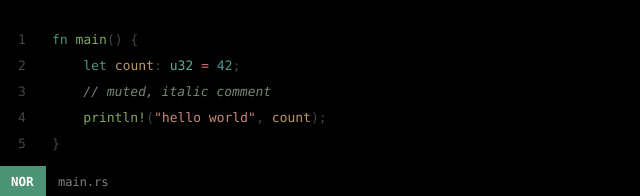
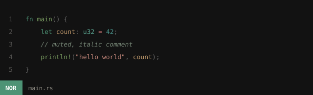
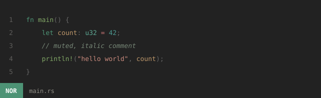
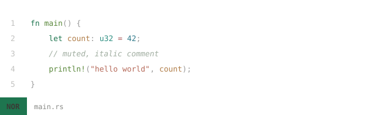
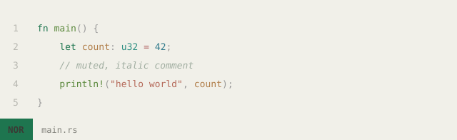
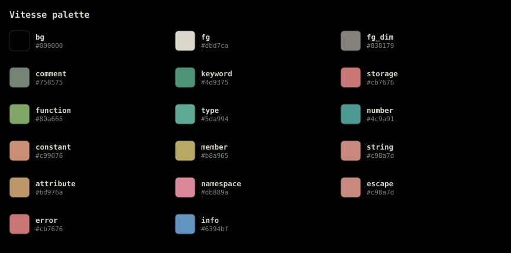
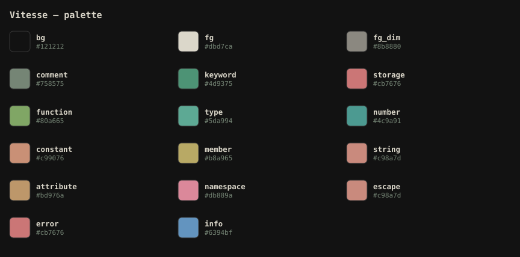
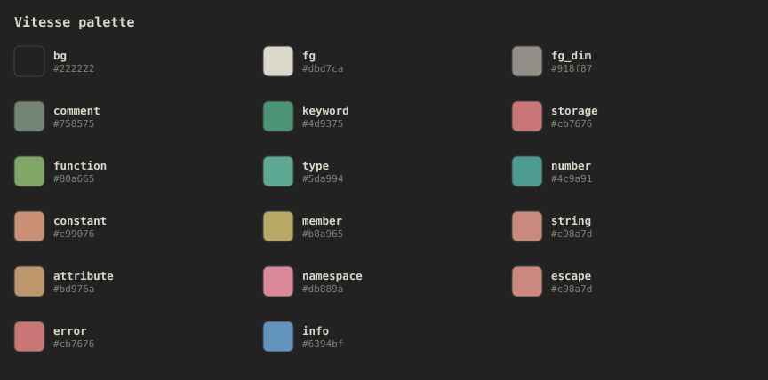
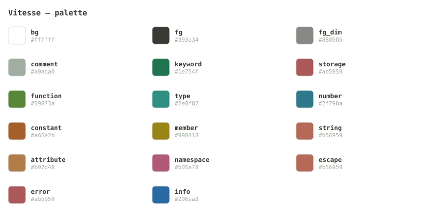
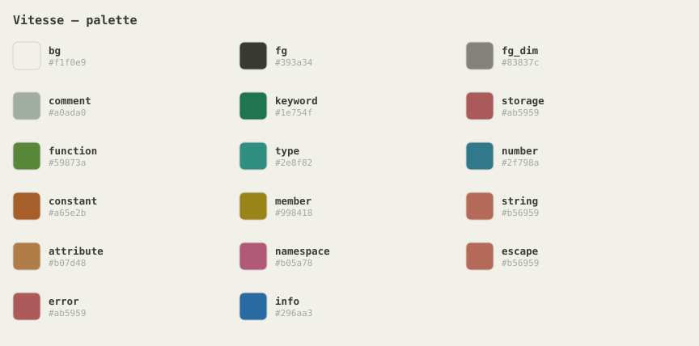

# vitesse-helix

**The complete Vitesse theme family for [Helix](https://helix-editor.com)**, all
five variants ported from [Vitesse](https://github.com/antfu/vscode-theme-vitesse)
by [Anthony Fu](https://github.com/antfu). None of these ship with Helix.



## Variants

| Theme | Background | Preview |
| --- | --- | --- |
| `vitesse-black` | `#000000` |  |
| `vitesse-dark` | `#121212` |  |
| `vitesse-dark-soft` | `#222222` |  |
| `vitesse-light` | `#ffffff` |  |
| `vitesse-light-soft` | `#f1f0e9` |  |

## Related

| Where | What |
| --- | --- |
| **[vinhnx/vitesse-helix](https://github.com/vinhnx/vitesse-helix)** | this repo: the themes |
| **[vinhnx/helix-config](https://github.com/vinhnx/helix-config)** | the Helix config that ships with these themes |
| **[Gist](https://gist.github.com/vinhnx/8bb4ef22e5ccfee5f839dbf1a31939ae)** | single-file snapshot, now pointing here |
| **[antfu/vscode-theme-vitesse](https://github.com/antfu/vscode-theme-vitesse)** | the original VS Code themes |

## Install

```sh
mkdir -p ~/.config/helix/themes
for t in black dark dark-soft light light-soft; do
  curl -fsSL "https://raw.githubusercontent.com/vinhnx/vitesse-helix/main/vitesse-$t.toml" \
    -o ~/.config/helix/themes/vitesse-$t.toml
done
```

Or install a single variant:

```sh
curl -fsSL https://raw.githubusercontent.com/vinhnx/vitesse-helix/main/vitesse-dark.toml \
  -o ~/.config/helix/themes/vitesse-dark.toml
```

Enable it in `~/.config/helix/config.toml`:

```toml
theme = "vitesse-black"   # or vitesse-dark, vitesse-light, ...
```

Then `:config-reload` in Helix, or try one live with `:theme vitesse-light`.

## Palettes

Every swatch below is generated from the theme file's own `[palette]` table, so
they cannot drift from what Helix actually renders.

<details open>
<summary><b>vitesse-black</b></summary>



</details>

<details>
<summary><b>vitesse-dark</b></summary>



</details>

<details>
<summary><b>vitesse-dark-soft</b></summary>



</details>

<details>
<summary><b>vitesse-light</b></summary>



</details>

<details>
<summary><b>vitesse-light-soft</b></summary>



</details>

## Why this port differs from the VS Code themes

Helix's theme loader reads only the first six digits of an `#rrggbbaa` color and
**ignores the alpha channel**; there is no compositing. Vitesse leans on
translucency throughout, so a naive translation renders wrong:

- The upstream foreground `#dbd7cacc` (86% alpha) would composite to a washed-out
  `#afaca2`. These themes use the intended `#dbd7ca` instead.
- `list.activeSelectionBackground` equals the editor background in Vitesse, which
  would make selections invisible. Selection surfaces are derived separately.
- Upstream's bracket-match tint (`#4d937520`) is invisible on `#000000`; it is
  re-tinted to stay visible.

Token colors are taken verbatim from upstream's `tokenColors`, not approximated.

### Contrast (WCAG AA)

| Variant | Body text | Dim text | Comments | Mode indicators |
| --- | --- | --- | --- | --- |
| `vitesse-black` | 14.6:1 | 5.4:1 | 5.4:1 | 5.7 / 7.6 / 8.4 |
| `vitesse-dark` | 13.0:1 | 5.3:1 | 4.8:1 | 5.7 / 7.6 / 8.4 |
| `vitesse-dark-soft` | 11.0:1 | 4.9:1 | 4.1:1 | 5.7 / 7.6 / 8.4 |
| `vitesse-light` | 11.5:1 | 3.5:1 | 2.3:1 | 5.7 / 4.9 / 4.9 |
| `vitesse-light-soft` | 10.1:1 | 3.3:1 | 2.0:1 | 5.7 / 4.9 / 4.9 |

Body text and mode indicators meet AA everywhere. In the light variants the dim
text and comments are deliberately soft; that is upstream's design, not a bug.

## Regenerating

Themes and artwork are both generated, so the repo stays reproducible:

```sh
python3 scripts/port-themes.py      # upstream/*.json -> vitesse-*.toml
python3 scripts/generate-assets.py  # vitesse-*.toml  -> assets/*.svg
```

`scripts/port-themes.py` is the single source of truth for how upstream maps
onto Helix scopes. `upstream/` holds the vendored VS Code theme JSON so a
regeneration does not depend on the network.

## License

MIT. Original Vitesse themes copyright (c) Anthony Fu, also MIT.

## See also

- [vinhnx/helix-config](https://github.com/vinhnx/helix-config): VS Code-flavored Helix config
- [Gist snapshot](https://gist.github.com/vinhnx/8bb4ef22e5ccfee5f839dbf1a31939ae): no longer maintained
- [antfu/vscode-theme-vitesse](https://github.com/antfu/vscode-theme-vitesse): upstream themes
- [Helix custom themes reference](https://docs.helix-editor.com/themes.html)
