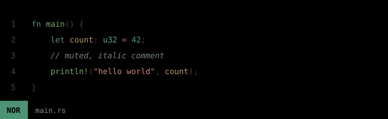
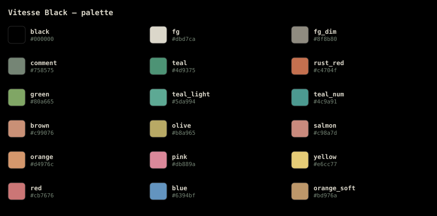

# vitesse-helix

**Vitesse for [Helix](https://helix-editor.com)** — a port of
[Vitesse](https://github.com/antfu/vscode-theme-vitesse) by
[Anthony Fu](https://github.com/antfu), the theme that isn't bundled with Helix.



## Related

| Where | What |
| --- | --- |
| 🎨 **[vinhnx/vitesse-helix](https://github.com/vinhnx/vitesse-helix)** | this repo — the theme |
| 📦 **[vinhnx/helix-config](https://github.com/vinhnx/helix-config)** | the Helix config that ships with this theme |
| 📄 **[Gist](https://gist.github.com/vinhnx/8bb4ef22e5ccfee5f839dbf1a31939ae)** | single-file snapshot, now pointing here |
| ⬆️ **[antfu/vscode-theme-vitesse](https://github.com/antfu/vscode-theme-vitesse)** | the original VSCode theme this ports |

## Palette

Every color is read from the theme's own `[palette]` table, so this swatch
matches the theme exactly.



## Install

```sh
mkdir -p ~/.config/helix/themes
curl -fsSL https://raw.githubusercontent.com/vinhnx/vitesse-helix/main/vitesse-black.toml \
  -o ~/.config/helix/themes/vitesse-black.toml
```

Enable it in `~/.config/helix/config.toml`:

```toml
theme = "vitesse-black"
```

Then run `:config-reload` inside Helix, or `:theme vitesse-black` to try it
without touching your config.

## Why this port differs from the VSCode theme

Helix's theme loader reads only the first six digits of an `#rrggbbaa` color and
**ignores the alpha channel** — there is no compositing. VSCode's Vitesse
leans on transparency throughout, so a naive port renders wrong.

Concretely, the upstream foreground is `#dbd7cacc` (86% alpha). Compositing that
onto `#000000` yields a washed-out `#afaca2`, which is *not* what the theme looks
like in VSCode. This port uses the intended `#dbd7ca` instead, and picks opaque
values for every other translucent color (selection, line numbers, indent
guides, diff backgrounds).

### Contrast

Text colors are checked against `#000000` for WCAG AA (4.5:1):

| Scope | Color | Contrast |
| --- | --- | --- |
| `ui.text` | `#dbd7ca` | 14.6:1 |
| `function` | `#80a665` | 7.6:1 |
| `type` | `#5da994` | 7.6:1 |
| `string` | `#c98a7d` | 7.4:1 |
| `constant.numeric` | `#4c9a91` | 6.3:1 |
| `keyword` | `#4d9375` | 5.7:1 |
| `comment` | `#758575` | 5.4:1 |

`ui.linenr` is intentionally dim (2.2:1), matching VSCode's line numbers.

Mode indicators use a colored background with black text:
normal `#4d9375` (5.7:1), insert `#80a665` (7.6:1), select `#d4976c` (8.4:1).

## Regenerating the images

The SVGs are generated from the theme file, so they can't drift:

```sh
python3 scripts/generate-assets.py
```

## License

MIT. Original Vitesse theme copyright (c) Anthony Fu, also MIT.

## See also

- 📦 [vinhnx/helix-config](https://github.com/vinhnx/helix-config) — VS Code-flavored Helix config
- 📄 [Gist snapshot](https://gist.github.com/vinhnx/8bb4ef22e5ccfee5f839dbf1a31939ae) — both files in one place, no longer maintained
- ⬆️ [antfu/vscode-theme-vitesse](https://github.com/antfu/vscode-theme-vitesse) — upstream theme
- 🖥️ [Helix custom themes reference](https://docs.helix-editor.com/themes.html)
